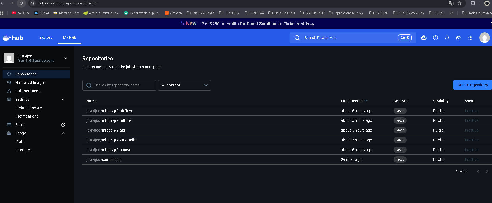
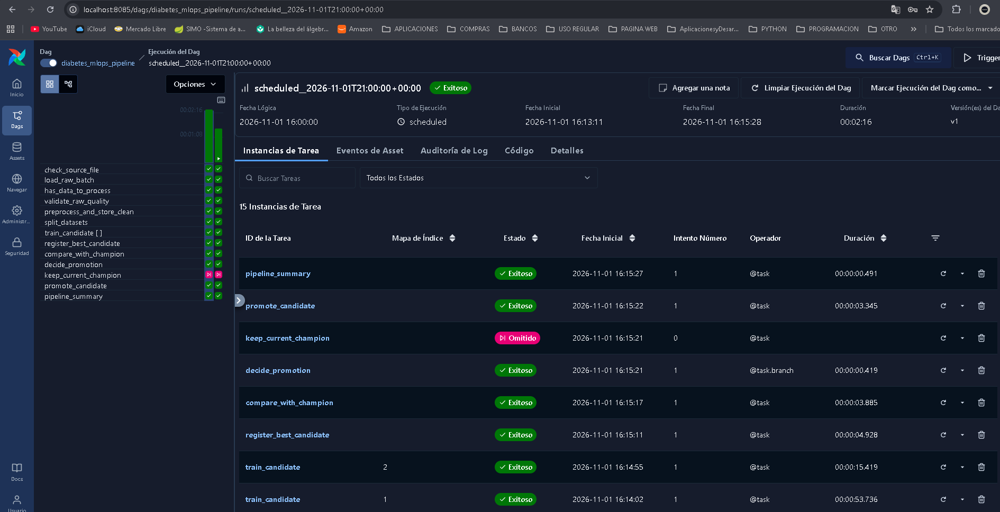
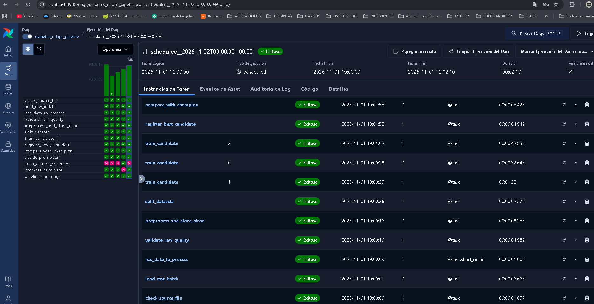
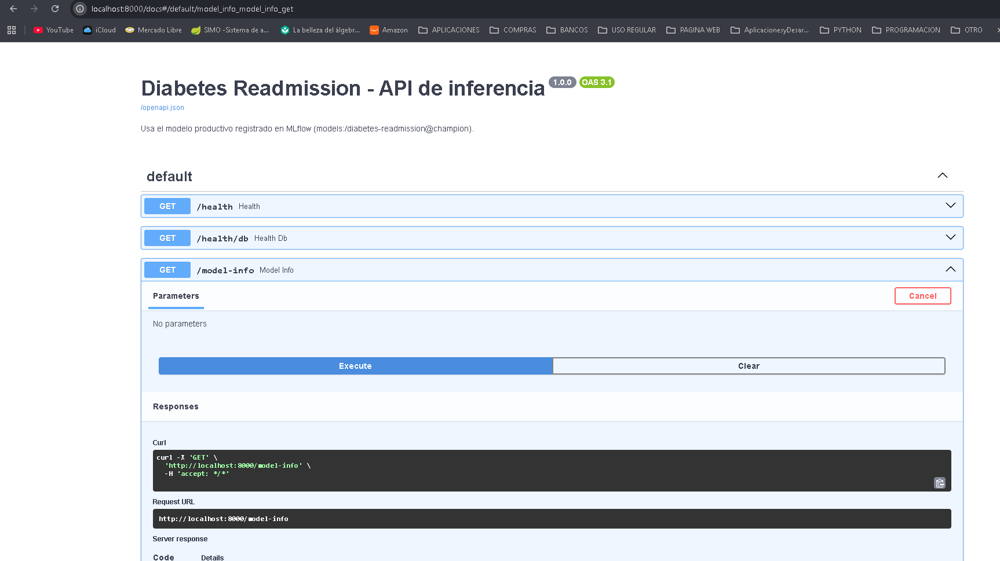
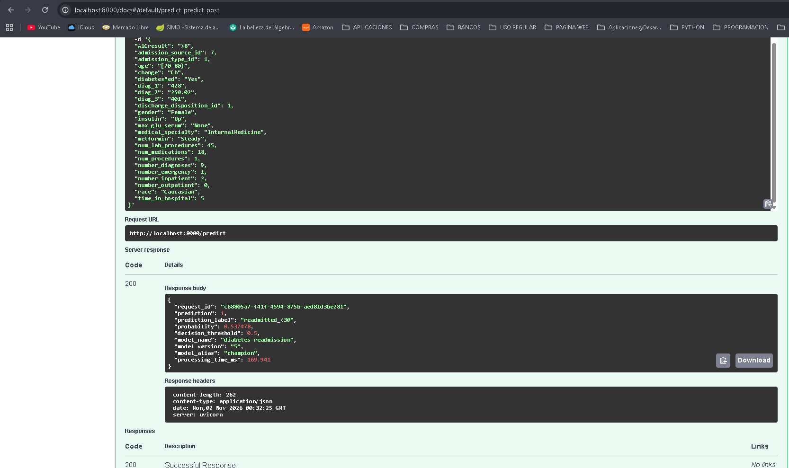
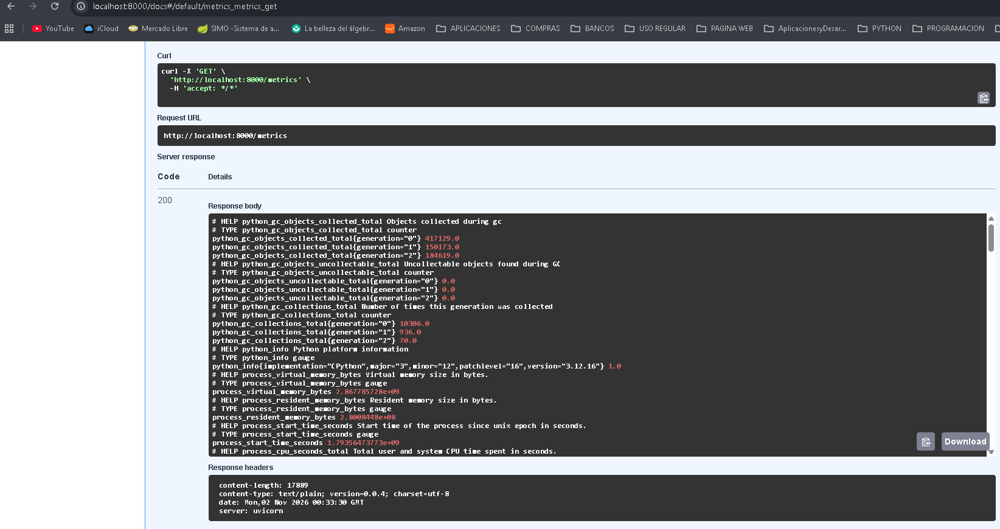
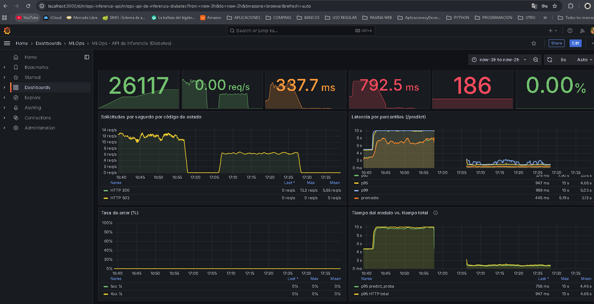
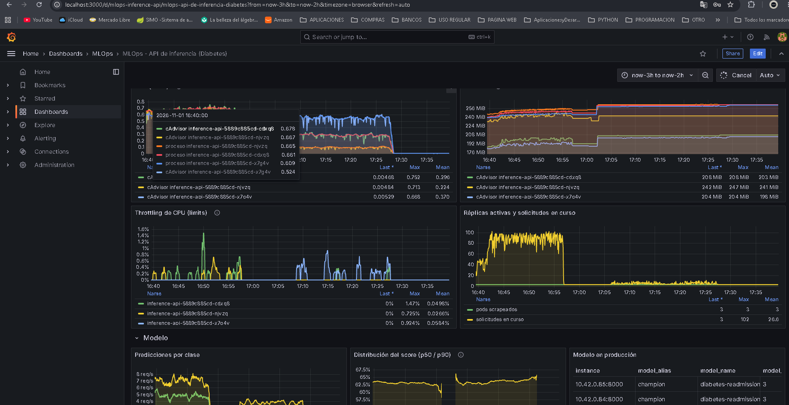

# Proyecto 2 – MLOps en Kubernetes (Rancher): readmisión hospitalaria de pacientes diabéticos

## Grupo 3

### Integrantes
* **Juan David Clavijo Ortiz**
* **Laura Sofía Rodríguez Pérez**
* **Joshua Alexander Valero Lozano**

## Link de Youtube: https://youtu.be/iDZpyuTl-RY

# Descripción

Arquitectura MLOps completa desplegada en Kubernetes administrado con **Rancher** sobre las VMs
Rocky, ingesta incremental orquestada con Airflow, capas RAW / CLEAN /
INFERENCE en PostgreSQL, experimentos y registro de modelos en MLflow (PostgreSQL + MinIO), API
de inferencia con FastAPI, interfaz en Streamlit, pruebas de carga con Locust y observabilidad
con Prometheus + Grafana.

**Problema:** predecir si un paciente diabético hospitalizado será readmitido en menos de
30 días (`readmitted == "<30"`), con el dataset *Diabetes 130-US hospitals (1999-2008)*.

## 1. Arquitectura

| Fase | Componente | Recurso en Kubernetes | Acceso |
|---|---|---|---|
| Entrenamiento | Airflow 3.1.8 (LocalExecutor) | Helm chart oficial 1.20.0 | NodePort 30080 |
| Entrenamiento | PostgreSQL de datos (`raw`, `clean`, `inference`) | StatefulSet + PVC + Job de migración | interno |
| Entrenamiento | MLflow 3.4.0 | Deployment | NodePort 30500 |
| Entrenamiento | PostgreSQL de metadatos de MLflow | StatefulSet + PVC | interno |
| Entrenamiento | MinIO (artefactos de MLflow) | StatefulSet + PVC | consola NodePort 30901 |
| Inferencia | API FastAPI | Deployment | NodePort 30800 |
| Inferencia | Streamlit | Deployment | NodePort 30501 |
| Inferencia | Locust | Deployment | NodePort 30089 |
| Observabilidad | Prometheus | Deployment + PVC + RBAC | NodePort 30909 |
| Observabilidad | Grafana | Deployment + PVC | NodePort 30300 |

Todos los contenedores tienen `requests`/`limits`, todos los servicios tienen probes, la
configuración está en ConfigMaps y las credenciales en Secrets. Todo vive en el namespace
`mlops`.

### 1.1 Definición detallada de los servicios contenidos

* **Apache Airflow 3.1.8 (LocalExecutor):** Plataforma de orquestación de flujos de trabajo encargada de programar, ejecutar y monitorear el pipeline de datos (`diabetes_mlops_pipeline`). Automatiza la ingesta incremental por lotes de 15.000 registros, la validación de calidad de datos, el preprocesamiento de características y el entrenamiento paralelo de modelos candidatos.
* **PostgreSQL de Datos (`postgres-data`):** Sistema de gestión de base de datos relacional que implementa la arquitectura de almacenamiento por capas mediante tres esquemas aislados: `raw` (ingesta inmutable en formato JSONB y control de lotes), `clean` (datos procesados, codificados y divididos en particiones de entrenamiento/validación/prueba) e `inference` (auditoría y registro histórico de predicciones en tiempo real).
* **Job de Migración (`db-migrate-job`):** Recurso de ejecución única en Kubernetes encargado de aplicar de forma idempotente los scripts SQL iniciales (creación de esquemas, tablas, vistas y permisos diferenciados como `api_writer`) sobre PostgreSQL de datos al levantar el entorno[cite: 2, 4].
* **MLflow 3.4.0:** Servidor centralizado para la gestión del ciclo de vida de los modelos de Machine Learning. Registra los experimentos (`diabetes-readmission`), almacena hiperparámetros y métricas de evaluación (F1, ROC-AUC, PR-AUC), y gestiona el *Model Registry* administrando la promoción entre versiones mediante los alias `@champion`, `@challenger` y `@previous-champion`.
* **PostgreSQL de Metadatos de MLflow (`postgres-mlflow`):** Instancia de base de datos relacional dedicada exclusivamente al backend de persistencia de MLflow. Almacena las entidades lógicas de los experimentos, ejecuciones (*runs*), métricas, parámetros, etiquetas y estados del registro de modelos sin interferir con los datos clínicos del problema.
* **MinIO:** Servicio de almacenamiento de objetos de alto rendimiento compatible con la API de Amazon S3. Actúa como el almacén de artefactos (*Artifact Store*) de MLflow, guardando de forma persistente los archivos serializados de los modelos entrenados (`model.pkl`), transformadores y metadatos asociados.
* **API de Inferencia (FastAPI):** Microservicio web asíncrono que expone el modelo campeón (`@champion`) en producción mediante endpoints RESTful (`/predict`, `/model-info`, `/reload-model`, `/metrics`). Valida esquemas de entrada con Pydantic, ejecuta la ingeniería de características en tiempo real, realiza *hot-swap* automático del modelo cada 60 segundos sin tiempo de inactividad y registra las predicciones en segundo plano (*BackgroundTasks*).
* **Streamlit:** Aplicación web interactiva que proporciona una interfaz gráfica de usuario (GUI) amigable para el personal clínico o de negocio. Permite probar el servicio de inferencia cargando casos predefinidos o ingresando parámetros manualmente, visualizando la probabilidad de readmisión hospitalaria y el detalle de validaciones de la API.
* **Locust:** Herramienta de pruebas de carga y estrés distribuida basada en Python. Simula múltiples usuarios concurrentes realizando peticiones sobre el Service interno de la API FastAPI para evaluar el rendimiento del clúster, medir tiempos de respuesta y determinar el punto de degradación operativa e impacto del escalado horizontal.
* **Prometheus:** Sistema de monitoreo y base de datos de series temporales. Recolecta métricas en tiempo real mediante *scraping* periódico tanto del endpoint `/metrics` expuesto por la API de inferencia como de las métricas de recursos de infraestructura (uso de CPU, memoria y *throttling* de contenedores) proveídas por Kubernetes.
* **Grafana:** Plataforma de análisis y visualización de datos conectada a Prometheus. Despliega de forma automática (mediante *provisioning*) el dashboard **MLOps - API de inferencia**, permitiendo observar en tiempo real la tasa de peticiones por segundo (RPS), latencias (p50, p95, p99), porcentaje de errores, distribución de clases predichas y consumo de cómputo de los pods.

## 2. Estructura del repositorio

```
├── .github/workflows/          CI: pruebas + publicación en DockerHub (plantilla del curso)[cite: 1, 3]
├── airflow/                    Igual que Niveles/3/Airflow/proyecto_base[cite: 1, 3]
│   ├── dags/                   DAG + módulos del pipeline (incluye features.py)[cite: 1, 3]
│   ├── data/                   Aquí va Diabetes.csv (se copia a la imagen)[cite: 1, 3]
│   ├── values/                 values-proyecto.yaml para despliegue con Helm[cite: 1, 3]
│   ├── Dockerfile              Imagen personalizada de Airflow 3.1.8[cite: 1, 3]
│   └── requirements.txt        Dependencias de Python para el pipeline[cite: 1, 3]
├── api/                        API FastAPI: Dockerfile, requirements.txt, main.py, features.py, ...[cite: 1, 3]
├── db/                         Scripts SQL de creación de tablas y esquemas (idempotentes)[cite: 1, 3]
├── evidencias/                 Capturas de pantalla de la ejecución y validación del proyecto[cite: 1, 3]
├── infra/                      Archivos y scripts de soporte de infraestructura[cite: 1, 3]
├── k8s/                        Manifiestos de Kubernetes (kubectl apply -f k8s/)[cite: 1, 2, 3, 4]
│   ├── 00-namespace.yaml       Definición del namespace mlops[cite: 2, 4]
│   ├── 01-secrets.yaml         Credenciales de bases de datos, MinIO y Grafana[cite: 2, 4]
│   ├── api-*.yaml              ConfigMap, Deployment y Service de FastAPI[cite: 2, 4]
│   ├── db-*.yaml               ConfigMap de scripts SQL y Job de migración (db-migrate-job)[cite: 2, 4]
│   ├── grafana-*.yaml          ConfigMaps de aprovisionamiento/dashboards, PVC, Deployment y Service[cite: 2, 4]
│   ├── locust-*.yaml           ConfigMap, Deployment y Service de Locust[cite: 2, 4]
│   ├── minio-*.yaml            ConfigMap, StatefulSet y Service de MinIO[cite: 2, 4]
│   ├── mlflow-*.yaml           ConfigMap, Deployment y Service de MLflow[cite: 2, 4]
│   ├── pipeline-configmap.yaml Variables globales de configuración del pipeline[cite: 2, 4]
│   ├── postgres-*.yaml         ConfigMaps, StatefulSets y Services de PostgreSQL (datos y MLflow)[cite: 2, 4]
│   ├── prometheus-*.yaml       ConfigMap, RBAC, PVC, Deployment y Service de Prometheus
│   └── streamlit-*.yaml        Deployment y Service de la interfaz Streamlit
├── locust/                     Dockerfile, requirements.txt, locustfile.py (como Niveles/3/locust)[cite: 1, 3]
├── mlflow/                     Dockerfile del servidor + creación del bucket en MinIO[cite: 1, 3]
├── observabilidad/             Configuración de monitoreo[cite: 1, 3]
│   ├── prometheus.yml          Configuración para docker compose y prometheus-k8s.yml (Kubernetes)
│   └── grafana/                provisioning/ y dashboards/mlops-inference-api.json
├── streamlit/                  Interfaz gráfica: Dockerfile, requirements.txt, app.py[cite: 1, 3]
├── tests/                      Pruebas unitarias con pytest (como Niveles/3/CICD/unit_testing)[cite: 1, 3]
├── .env.example                Variables de entorno de ejemplo para docker compose
├── .gitignore                  Archivos y directorios excluidos de Git[cite: 1, 3]
├── docker-compose.yaml         Desarrollo local + build/push de imágenes[cite: 1, 3]
├── links.txt                   Enlaces de interés y referencias del proyecto[cite: 1, 3]
├── local-path-storage.yaml     Manifiesto del aprovisionador de almacenamiento local de Rancher[cite: 1, 3]
└── README.md                   Documentación principal del proyecto[cite: 1, 3]
```

## 3. Preparación del entorno, Red y Firewall

### 3.1 Verificación del clúster
Asegúrese de tener acceso al clúster de Kubernetes desde la terminal de su máquina virtual:

```bash
kubectl cluster-info
kubectl get nodes -o wide
```

### 3.2 StorageClass (necesaria para los PVC)

```bash
kubectl get storageclass
```

- Clúster `local` (K3s): ya trae `local-path (default)`. No hay que hacer nada.
- Clúster Custom **RKE2**: **no trae ninguna**, y sin ella todos los PVC quedan en `Pending`. Instale el aprovisionador de Rancher (incluido en la raíz del repositorio como `local-path-storage.yaml` o desde su URL oficial) y márquelo por defecto[cite: 1, 3]:

```bash
# Usando el archivo local del repositorio:
kubectl apply -f local-path-storage.yaml

# O directamente desde el repositorio oficial de Rancher:
kubectl apply -f [https://raw.githubusercontent.com/rancher/local-path-provisioner/v0.0.31/deploy/local-path-storage.yaml](https://raw.githubusercontent.com/rancher/local-path-provisioner/v0.0.31/deploy/local-path-storage.yaml)

# Marcar local-path como StorageClass por defecto:
kubectl patch storageclass local-path -p '{"metadata":{"annotations":{"storageclass.kubernetes.io/is-default-class":"true"}}}'
```

### 3.3 Procedimiento para la liberación de `firewalld` en la Máquina Virtual
Los NodePort (`30000-32767`) deben estar abiertos en el cortafuegos del sistema operativo de las máquinas virtuales para permitir el acceso externo a las interfaces web y al tráfico interno del clúster. Siga este procedimiento en la VM:

1. **Verificar el estado del servicio `firewalld`:**
   ```bash
   sudo systemctl status firewalld
   ```

2. **Opción A – Abrir los puertos específicos del proyecto y el rango NodePort:**
   Ejecute los siguientes comandos para liberar permanentemente los puertos utilizados por cada servicio y el rango estándar de Kubernetes:
   ```bash
   # Puertos específicos de los servicios MLOps
   sudo firewall-cmd --permanent --add-port=30080/tcp  # Airflow Webserver
   sudo firewall-cmd --permanent --add-port=30089/tcp  # Locust UI
   sudo firewall-cmd --permanent --add-port=30300/tcp  # Grafana
   sudo firewall-cmd --permanent --add-port=30500/tcp  # MLflow UI
   sudo firewall-cmd --permanent --add-port=30501/tcp  # Streamlit UI
   sudo firewall-cmd --permanent --add-port=30800/tcp  # FastAPI (Swagger / Predict)
   sudo firewall-cmd --permanent --add-port=30901/tcp  # Consola MinIO
   sudo firewall-cmd --permanent --add-port=30909/tcp  # Prometheus UI

   # Rango completo de NodePorts de Kubernetes y puertos de reenvío local
   sudo firewall-cmd --permanent --add-port=30000-32767/tcp
   sudo firewall-cmd --permanent --add-port=8080/tcp
   sudo firewall-cmd --permanent --add-port=8501/tcp
   sudo firewall-cmd --permanent --add-port=3000/tcp

   # Recargar el firewall para aplicar los cambios inmediatamente
   sudo firewall-cmd --reload

   # Confirmar que las reglas quedaron activas
   sudo firewall-cmd --list-ports
   ```

3. **Opción B – Deshabilitar `firewalld` por completo:**
   Si en el laboratorio de máquinas virtuales el tráfico de los pods o la resolución DNS entre nodos se ve bloqueada por reglas restrictivas de `firewalld`, puede detenerlo y deshabilitarlo con:
   ```bash
   sudo systemctl stop firewalld
   sudo systemctl disable firewalld
   sudo systemctl status firewalld
   ```

## 3.4 Procedimiento para la habilitación de puertos desde Visual Studio Code
Cuando se conecta a la máquina virtual mediante la extensión **Remote - SSH** de Visual Studio Code, puede habilitar y redirigir los puertos de los servicios directamente hacia el navegador de su equipo local siguiendo estos pasos:

1. **Abrir el panel de Puertos:**
   - En la barra inferior de estado o en el panel de la terminal integrada (junto a *TERMINAL*, *OUTPUT*, *DEBUG CONSOLE*), seleccione la pestaña **PORTS** (Puertos).
   - También puede abrirla presionando `Ctrl + Shift + P` (o `Cmd + Shift + P` en macOS) y ejecutando el comando **`Ports: Focus on Ports View`**.

2. **Agregar los puertos de los servicios:**
   - Haga clic en el botón **`Forward a Port`** (Reenviar un puerto) o **`Add Port`**.
   - Si trabaja sobre un clúster con acceso directo a **NodePorts**, agregue los puertos:
     - `30080` (Airflow)
     - `30500` (MLflow)
     - `30901` (MinIO)
     - `30800` (API FastAPI)
     - `30501` (Streamlit)
     - `30089` (Locust)
     - `30909` (Prometheus)
     - `30300` (Grafana)
   - Si trabaja con **`kubectl port-forward`** en el clúster `local`, agregue los puertos locales mapeados (por ejemplo: `8080`, `8501`, `3000`, `5000`, `8000`, `8089`, `9001`, `9090`).

3. **Configurar visibilidad y acceder desde el navegador:**
   - En la tabla de la pestaña **PORTS**, verifique que la columna **Forwarded Address** muestre `localhost:<puerto>`.
   - *(Opcional)* Si requiere que el puerto sea accesible desde otra máquina en la misma red, haga clic derecho sobre la fila del puerto, seleccione **Port Visibility** y cámbielo de `Private` a **`Public`**.
   - Pase el cursor sobre la dirección en **Forwarded Address** y haga clic en el ícono del globo (**Open in Browser**) o copie `http://localhost:<puerto>` en su navegador local.


## 4. Construir y publicar las imágenes (DockerHub)

Cada imagen se construye dentro de su carpeta, como en los ejercicios:

  <p align="center">
    
  </p>

```bash
docker login

cd airflow
curl -L "[https://drive.usercontent.google.com/download?id=1k5-1caezQ3zWJbKaiMULTGq-3sz6uThC&export=download&confirm=t](https://drive.usercontent.google.com/download?id=1k5-1caezQ3zWJbKaiMULTGq-3sz6uThC&export=download&confirm=t)" -o data/Diabetes.csv
docker build --build-arg AIRFLOW_BASE_TAG=3.1.8 -t su_usuario/mlops-p2-airflow:0.1.0 .
docker push su_usuario/mlops-p2-airflow:0.1.0
cd ..

cd mlflow    && docker build -t su_usuario/mlops-p2-mlflow:0.1.0 .    && docker push su_usuario/mlops-p2-mlflow:0.1.0    && cd ..
cd api       && docker build -t su_usuario/mlops-p2-api:0.1.0 .       && docker push su_usuario/mlops-p2-api:0.1.0       && cd ..
cd streamlit && docker build -t su_usuario/mlops-p2-streamlit:0.1.0 . && docker push su_usuario/mlops-p2-streamlit:0.1.0 && cd ..
cd locust    && docker build -t su_usuario/mlops-p2-locust:0.1.0 .    && docker push su_usuario/mlops-p2-locust:0.1.0    && cd ..
```

Otra opción para las cuatro últimas imágenes: `cp .env.example .env`, poner su usuario en `DOCKERHUB_USER` y ejecutar `docker compose build` y luego `docker compose push`.

Si `airflow/data/Diabetes.csv` no está en la imagen, la primera tarea del DAG lo descarga. Cuando cambie el código, suba el tag (`0.1.1`, `0.1.2`…) en el build y en los manifiestos, como indica la guía de Airflow.

Si construye en un Mac con chip Apple, agregue `--platform linux/amd64` al `docker build`, porque las VMs son x86.

## 5. Desplegar en Kubernetes y Comandos de Levantamiento

### 5.1 Levantamiento general rápido (Todos los servicios)

```bash
# 1. Su usuario de DockerHub en los manifiestos y en los values de Airflow
sed -i 's/DOCKERHUB_USER/su_usuario/g' k8s/*.yaml airflow/values/values-proyecto.yaml

# 2. Cambie las contraseñas en k8s/01-secrets.yaml (iguales a las del .env)

# 3. Aplicar todo
kubectl apply -f k8s/
kubectl config set-context --current --namespace=mlops    # para no escribir -n mlops
kubectl get pods -w                                       # esperar Running / Completed

# 4. Airflow con Helm (guía Niveles/3/Airflow)
helm repo add apache-airflow [https://airflow.apache.org](https://airflow.apache.org) && helm repo update
helm upgrade --install airflow apache-airflow/airflow --version 1.20.0 \
  --namespace mlops -f airflow/values/values-proyecto.yaml --wait --timeout 20m
```

### 5.2 Comandos detallados para el levantamiento paso a paso por servicio
Si desea levantar, verificar o reiniciar cada componente de forma controlada e individual dentro del clúster, utilice la siguiente secuencia de comandos[cite: 2, 4]:

```bash
# 1. Crear el namespace y establecerlo por defecto en el contexto actual
kubectl apply -f k8s/00-namespace.yaml
kubectl config set-context --current --namespace=mlops

# 2. Cargar Secrets y ConfigMaps globales del pipeline y scripts SQL
kubectl apply -f k8s/01-secrets.yaml
kubectl apply -f k8s/pipeline-configmap.yaml
kubectl apply -f k8s/db-sql-configmap.yaml

# 3. Levantar PostgreSQL de Datos y ejecutar el Job de migración de esquemas (raw, clean, inference)
kubectl apply -f k8s/postgres-data-configmap.yaml
kubectl apply -f k8s/postgres-data-statefulset.yaml
kubectl apply -f k8s/postgres-data-service.yaml
kubectl rollout status statefulset/postgres-data
kubectl apply -f k8s/db-migrate-job.yaml
kubectl wait --for=condition=complete job/data-db-migrate --timeout=120s

# 4. Levantar PostgreSQL de Metadatos de MLflow y MinIO (Almacenamiento S3)
kubectl apply -f k8s/postgres-mlflow-configmap.yaml \
                 k8s/postgres-mlflow-statefulset.yaml \
                 k8s/postgres-mlflow-service.yaml
kubectl apply -f k8s/minio-configmap.yaml \
                 k8s/minio-statefulset.yaml \
                 k8s/minio-service.yaml
kubectl rollout status statefulset/minio

# 5. Levantar el servidor de MLflow
kubectl apply -f k8s/mlflow-configmap.yaml \
                 k8s/mlflow-deployment.yaml \
                 k8s/mlflow-service.yaml
kubectl rollout status deployment/mlflow

# 6. Levantar Apache Airflow mediante Helm
helm repo add apache-airflow [https://airflow.apache.org](https://airflow.apache.org) && helm repo update
helm upgrade --install airflow apache-airflow/airflow --version 1.20.0 \
  --namespace mlops -f airflow/values/values-proyecto.yaml --wait --timeout 20m

# 7. Levantar la capa de Inferencia (API FastAPI, Interfaz Streamlit y Locust)
kubectl apply -f k8s/api-configmap.yaml \
                 k8s/api-deployment.yaml \
                 k8s/api-service.yaml
kubectl apply -f k8s/streamlit-deployment.yaml \
                 k8s/streamlit-service.yaml
kubectl apply -f k8s/locust-configmap.yaml \
                 k8s/locust-deployment.yaml \
                 k8s/locust-service.yaml

# 8. Levantar la capa de Observabilidad (Prometheus y Grafana)
kubectl apply -f k8s/prometheus-configmap.yaml \
                 k8s/prometheus-rbac.yaml \
                 k8s/prometheus-pvc.yaml \
                 k8s/prometheus-deployment.yaml \
                 k8s/prometheus-service.yaml
kubectl apply -f k8s/grafana-configmap.yaml \
                 k8s/grafana-datasources-configmap.yaml \
                 k8s/grafana-dashboard-providers-configmap.yaml \
                 k8s/grafana-dashboards-configmap.yaml \
                 k8s/grafana-pvc.yaml \
                 k8s/grafana-deployment.yaml \
                 k8s/grafana-service.yaml

# 9. Verificar que todos los pods, servicios y volúmenes estén activos
kubectl get pods,svc,pvc -n mlops
```

### 5.3 Levantamiento en entorno de desarrollo local (`docker compose`)
Para levantar los servicios localmente fuera de Kubernetes utilizando `docker-compose.yaml`[cite: 1, 3]:

```bash
cp .env.example .env
docker compose up -d --build
docker compose ps
```

## 6. Acceso a las interfaces

En un clúster **Custom RKE2**, use la IP de cualquier nodo:

| Interfaz | URL | Credenciales |
|---|---|---|
| Airflow | http://IP_NODO:30080 | admin / admin (usuario por defecto del chart) |
| MLflow | http://IP_NODO:30500 | – |
| MinIO | http://IP_NODO:30901 | `minio-secret` |
| API (Swagger) | http://IP_NODO:30800/docs | – |
| Streamlit | http://IP_NODO:30501 | – |
| Locust | http://IP_NODO:30089 | – |
| Prometheus | http://IP_NODO:30909 | – |
| Grafana | http://IP_NODO:30300 | `grafana-secret` |

En el clúster **`local`**, los NodePort quedan dentro del contenedor de Rancher, así que se usa `port-forward` como en la guía:

```bash
kubectl port-forward -n mlops --address 0.0.0.0 svc/airflow-api-server 8080:8080 &
kubectl port-forward -n mlops --address 0.0.0.0 svc/mlflow 5000:5000 &
kubectl port-forward -n mlops --address 0.0.0.0 svc/minio 9001:9001 &
kubectl port-forward -n mlops --address 0.0.0.0 svc/inference-api 8000:8000 &
kubectl port-forward -n mlops --address 0.0.0.0 svc/streamlit 8501:8501 &
kubectl port-forward -n mlops --address 0.0.0.0 svc/locust 8089:8089 &
kubectl port-forward -n mlops --address 0.0.0.0 svc/prometheus 9090:9090 &
kubectl port-forward -n mlops --address 0.0.0.0 svc/grafana 3000:3000 &
# ... puede ejecutarlos uno por terminal (sin &) o en segundo plano (con & al final)
```

# 7. Ejecución y validación

1. **Airflow:** active `diabetes_mlops_pipeline` y ejecútelo. Cada ejecución carga **un lote de 15.000 filas**: el dataset (~101.766 filas) requiere 7 ejecuciones. Al terminar los datos, el DAG se detiene en `has_data_to_process`, salvo que se lance con `force_retrain=true`.

    <p align="center">
      
    </p>

    <p align="center">
      
    </p>

2. **Capas de datos:**
   ```bash
   kubectl exec -it postgres-data-0 -- psql -U mlops -d diabetes -c "SELECT batch_id, rows_read, rows_inserted, status FROM raw.load_batches;"
   kubectl exec -it postgres-data-0 -- psql -U mlops -d diabetes -c "SELECT status, count(*) FROM raw.diabetes_raw GROUP BY 1;"
   kubectl exec -it postgres-data-0 -- psql -U mlops -d diabetes -c "SELECT split, count(*), avg(readmitted_30) FROM clean.diabetes_clean GROUP BY 1;"
   kubectl exec -it postgres-data-0 -- psql -U mlops -d diabetes -c "SELECT requested_at, prediction_label, probability, model_version, latency_ms FROM inference.prediction_logs ORDER BY id DESC LIMIT 5;"
   ```
3. **MLflow:** experimento `diabetes-readmission` (3 runs por ejecución) y modelo registrado `diabetes-readmission` con los alias `@champion`, `@challenger` y `@previous-champion`.

   <p align="center">
      
    </p>

    <p align="center">
      
    </p>

4. **API:**
   ```bash
   curl http://IP_NODO:30800/model-info
   curl -X POST http://IP_NODO:30800/predict -H "Content-Type: application/json" -d '{"gender":"Female","age":"[70-80)","admission_type_id":1,"discharge_disposition_id":1,"admission_source_id":7,"time_in_hospital":5,"num_lab_procedures":45,"num_procedures":1,"num_medications":18,"diag_1":"428","number_diagnoses":9,"insulin":"Up","diabetesMed":"Yes"}'
   ```
    <p align="center">
      
    </p>

    <p align="center">
      
    </p>

    <p align="center">
      
    </p>

5. **Streamlit:** use "Cargar ejemplo" y "Predecir". El escenario "Caso inválido" muestra los errores de validación de la API campo por campo.

## 8. Pruebas de carga y observabilidad

Grafana abre directamente el dashboard **MLOps - API de inferencia**, que incluye: total de solicitudes, solicitudes por segundo, latencia promedio, latencias p50/p95/p99, errores, tasa de error, CPU y memoria del pod, *throttling* de CPU, predicciones por clase y modelo en producción.

  <p align="center">
    
  </p>

  <p align="center">
    
  </p>

## 8. Pruebas de carga y observabilidad

Grafana abre directamente el dashboard **MLOps - API de inferencia**, que incluye: total de
solicitudes, solicitudes por segundo, latencia promedio, latencias p50/p95/p99, errores, tasa de
error, CPU y memoria del pod, *throttling* de CPU, predicciones por clase y modelo en producción.

  <p align="center">
    
  </p>


  <p align="center">
    
  </p>


**Cómo encontrar el punto de degradación:**

1. Con la API en 1 réplica (limit de 1 CPU), en Locust suba usuarios gradualmente (10, 25,
   50, 100…), o active el modo escalonado con `LOCUST_STEP_LOAD: "true"` en
   `k8s/locust-configmap.yaml` y reinicie Locust.
2. El límite operativo es el punto donde las RPS dejan de crecer mientras el p95 sigue subiendo.
   Debería coincidir con CPU cerca de 1 core y aumento del throttling.
3. Escale con `kubectl scale deploy/inference-api --replicas=3` y repita. Prometheus descubre
   las réplicas nuevas automáticamente. En un clúster multinodo, `kubectl get pods -o wide`
   muestra en qué nodo quedó cada una.

Locust corre dentro del clúster contra el Service de la API, así que la carga no pasa por un
port-forward, que sería un cuello de botella artificial.

## 9. Decisiones técnicas

### 9.1 Capas de datos

Una instancia de PostgreSQL con tres esquemas separados (`raw`, `clean`, `inference`) y una instancia aparte para MLflow. Los esquemas permiten permisos distintos por capa: la API usa el usuario `api_writer`, que solo puede hacer `INSERT` en `inference.prediction_logs` y recibe *permission denied* sobre `raw` y `clean`. La BD de MLflow queda aislada porque su esquema lo administra MLflow con sus propias migraciones.

- **RAW** (`raw.diabetes_raw`): la fila original completa en `JSONB`, sin transformar (los `?` se conservan). Incluye `batch_id`, `load_timestamp`, `source_file`, `source_row_number`, `row_hash` (único) y `status`. Nunca se sobrescribe: solo cambia el estado (NEW → VALID / REJECTED / DUPLICATE → PROCESSED / EXCLUDED).
- **CLEAN** (`clean.diabetes_clean`): características listas para entrenar, con la partición asignada y trazabilidad a RAW (`raw_id`).
- **INFERENCE** (`inference.prediction_logs`): cada solicitud con su entrada, características, predicción, probabilidad, modelo, versión, alias, latencia y `request_id`. La vista `inference.v_hourly_summary` resume el tráfico por hora.

### 9.2 Idempotencia, periodicidad y fallos del DAG

- **Periodicidad:** `@hourly` (configurable con `PIPELINE_SCHEDULE`). Con `max_active_runs=1` nunca hay dos ejecuciones compitiendo por el mismo offset.
- **Sin duplicados:** el offset se calcula desde los lotes `COMPLETED` en la BD, no desde memoria. Además, `row_hash` tiene restricción `UNIQUE` con `ON CONFLICT DO NOTHING`. Si se reintenta la misma ejecución, se reutiliza el lote que ya cargó.
- **Atomicidad:** cada tarea escribe en una sola transacción (con un *advisory lock* en la carga). Si falla, hace rollback y la siguiente ejecución retoma: lo que quedó en NEW o VALID se procesa en la próxima ejecución.
- **Fallos visibles:** si más del 10 % de las filas del lote se rechazan, la tarea falla en Airflow y el reporte queda en `raw.quality_checks`. Si una partición queda sin suficientes positivos, también falla. Cada tarea tiene 1 reintento.

### 9.3 Transformaciones (`features.py`)

| Decisión | Justificación |
|---|---|
| Se eliminan `weight` y `payer_code` | ~97 % y ~40 % de faltantes; `payer_code` es administrativa |
| Se eliminan `examide` y `citoglipton` | Constantes: varianza cero |
| Se excluyen altas por fallecimiento u hospicio (IDs 11, 13, 14, 19, 20, 21) | Esos pacientes no pueden ser readmitidos |
| `diag_1/2/3` se agrupan en 9 categorías ICD-9 | Más de 700 códigos con muy pocos casos cada uno |
| `age` se convierte en el punto medio del rango | Preserva el orden |
| IDs de admisión y alta se agrupan | Agrupa códigos "NULL", "Not Mapped" y similares en Unknown |
| `medical_specialty`: 13 principales + Surgery + Other + Unknown | Alta cardinalidad; `?` = Unknown |
| Nulos categóricos → `Unknown`; `max_glu_serum`/`A1Cresult` faltantes → `None` | "None" significa "no medido", una categoría con significado clínico |
| Nuevas variables: `service_utilization`, `num_meds_changed`, `num_meds_active` | Resumen de visitas previas y de los 23 medicamentos |
| One-hot encoding (`handle_unknown="ignore"`, `min_frequency=20`) dentro del Pipeline | Robusto a categorías nuevas en producción |

`features.py` está en `airflow/dags/diabetes_pipeline/` y en `api/`, con exactamente el mismo contenido. Así el modelo recibe en producción las mismas columnas con las que se entrenó, lo que evita el *training/serving skew*. La prueba `tests/test_features.py` falla si las dos copias dejan de ser idénticas, así que si modifica una, copie el cambio a la otra.

### 9.4 Particiones

La partición se asigna con un hash de `patient_nbr`: 70 % train, 15 % val y 15 % test. El mismo paciente siempre queda en la misma partición aunque llegue en lotes distintos, así que no hay fuga entre train y test, y la partición es reproducible entre ejecuciones.

### 9.5 Métrica principal y selección de modelos

La métrica principal es **F1 de la clase positiva (`<30`)**. La clase positiva es ~11 % del total, así que un modelo que siempre responde "NO" tendría ~89 % de accuracy y sería inútil. F1 equilibra recall (detectar pacientes en riesgo) y precisión (no saturar al equipo clínico con falsas alarmas). También se registran ROC-AUC y PR-AUC como apoyo, porque no dependen del umbral. Se puede cambiar con `PRIMARY_METRIC`.

Por ejecución se entrenan 3 candidatos en paralelo: regresión logística, random forest y HistGradientBoosting, todos con `class_weight` balanceado. El mejor en validación se registra como `@challenger`. Luego se re-evalúa el `@champion` sobre **el mismo conjunto de prueba vigente**, y solo se promueve el challenger si lo supera. El campeón anterior queda como `@previous-champion` para poder hacer rollback.

### 9.6 Carga del modelo en la API

La API resuelve `models:/diabetes-readmission@champion` al iniciar y carga esa versión una sola vez. Un hilo consulta cada 60 s a qué versión apunta el alias y, si cambió, descarga la nueva y la reemplaza de forma atómica, sin reiniciar el pod. `POST /reload-model` fuerza la consulta. Si MLflow cae, la API sigue sirviendo con el último modelo cargado. Nunca se descarga el modelo por solicitud y no hay versiones ni rutas escritas en el código. El registro en la BD se hace como *BackgroundTask*, así que no suma latencia a la respuesta.

### 9.7 Versiones fijadas (problemas encontrados en la validación)

| Hallazgo | Solución |
|---|---|
| `mlflow` 2.x exige `packaging<25`, y Airflow 3.1.8 exige `packaging>=25`: no se pueden instalar juntos | MLflow **3.4.0** en todas las imágenes |
| MLflow 3.4 falla al arrancar con SQLAlchemy 2.1 (`FallbackAsyncAdaptedQueuePool`) | `sqlalchemy==2.0.36` en la imagen de MLflow |
| La imagen `apache/airflow:3.1.8` ya trae numpy 2.4.2, pandas 2.3.3 y scikit-learn 1.8.0 | Mismas versiones en Airflow y en la API (el pickle del modelo depende de ellas) |
| El chart de Airflow más reciente ya no corresponde a Airflow 3.1.8 | Chart fijado en 1.20.0 (`AIRFLOW_CHART_VERSION`) |
| `build_features` tardaba 32 ms por fila en la API | Reescrito con numpy: 9,5 ms, con salida idéntica verificada sobre 40.025 filas |


# 10. Validación realizada

Antes de entregar la estructura se ejecutó una prueba de punta a punta (fuera de Kubernetes) con PostgreSQL 16, el servidor MLflow 3.4.0 levantado con el mismo comando del Deployment, Airflow 3.1.8 real (`airflow dags test`) y un dataset sintético de 40.025 filas con el esquema del original:

- 4 ejecuciones del DAG: 3 lotes (15.000 + 15.000 + 10.025) y una cuarta que se detuvo en el short-circuit al no quedar datos.
- RAW: 60 filas rechazadas, 25 duplicadas y 8.880 excluidas, cada una con su motivo. Ningún paciente quedó en más de una partición.
- MLflow: 9 runs con métricas y artefactos; versiones v1 → v2 → v3 promovidas por comparación contra el campeón, con alias y tags. Una quinta ejecución con `force_retrain` generó v4, que empató con el campeón y fue rechazada (rama `keep_current_champion`), como corresponde.
- API: el hot-swap funcionó (mover `@champion` de v3 a v1 cambió el modelo servido sin reiniciar), los 422 se devuelven correctamente y hubo 0 fallos al registrar en BD.
- Streamlit: los tres escenarios de ejemplo funcionaron.
- Locust: 0 fallos.

Las métricas de calidad de esa prueba no son representativas, porque los datos eran
sintéticos. Los resultados reales saldrán al ejecutar el DAG con el dataset del curso.

Los manifiestos de `k8s/` se validaron con kubeconform (43 recursos válidos en Kubernetes 1.30)
y los values de Helm contra el esquema oficial del chart 1.20.0.

## 11. Problemas comunes

| Síntoma | Causa probable / solución |
|---|---|
| PVC en `Pending` | No hay StorageClass por defecto (clúster RKE2): ver §3.2 |
| `ImagePullBackOff` en imágenes propias | No se reemplazó `DOCKERHUB_USER`, la imagen no se publicó o el tag no coincide |
| Cambié código y Kubernetes sigue usando la versión anterior | Construya con un tag nuevo y actualícelo en el manifiesto (con el mismo tag, el nodo reutiliza la imagen que ya tiene) |
| Pods de Airflow en `CreateContainerConfigError` | Se instaló Airflow antes de `kubectl apply -f k8s/` (faltan `pipeline-config` y `postgres-data-secret`) |
| La API responde 503 en `/predict` | Todavía no hay `@champion`: ejecute el DAG |
| `check_source_file` falla | Falta `airflow/data/Diabetes.csv` en la imagen y el pod no tiene salida a Internet |
| El DAG no aparece | `kubectl logs deploy/airflow-dag-processor`; verifique el tag de la imagen de Airflow |
| Error `invalid choice: 'api-server'` en Airflow | Chart e imagen desalineados: chart 1.20.0 ↔ Airflow 3.1.8 |
| Grafana sin datos de CPU de cAdvisor | El clúster restringe `nodes/proxy`; las métricas del proceso de la API funcionan igual |
