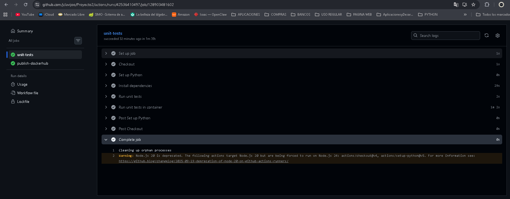
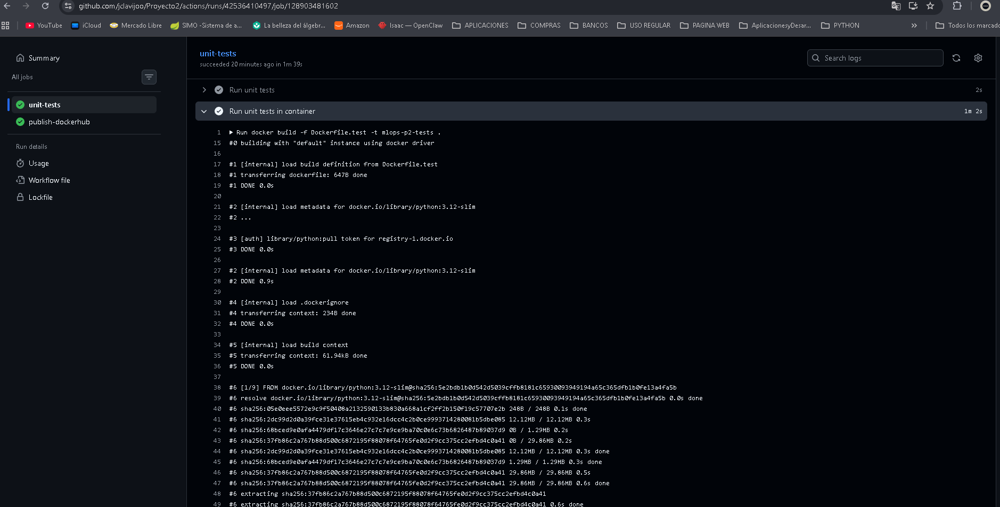
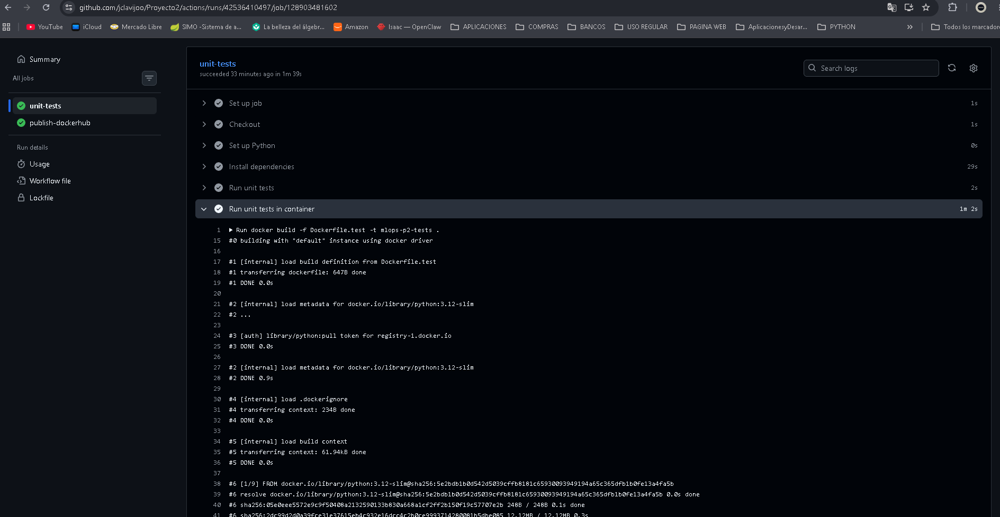
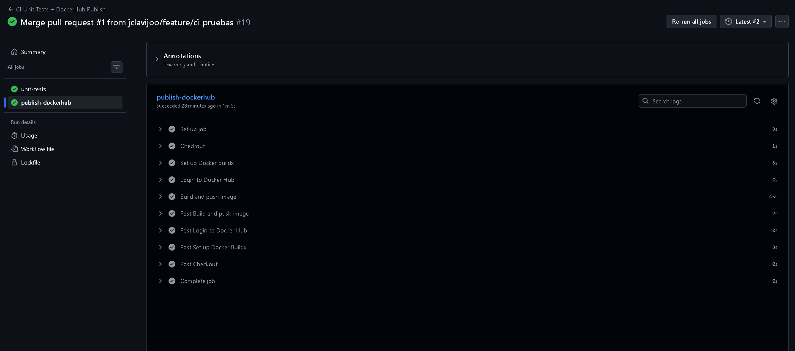
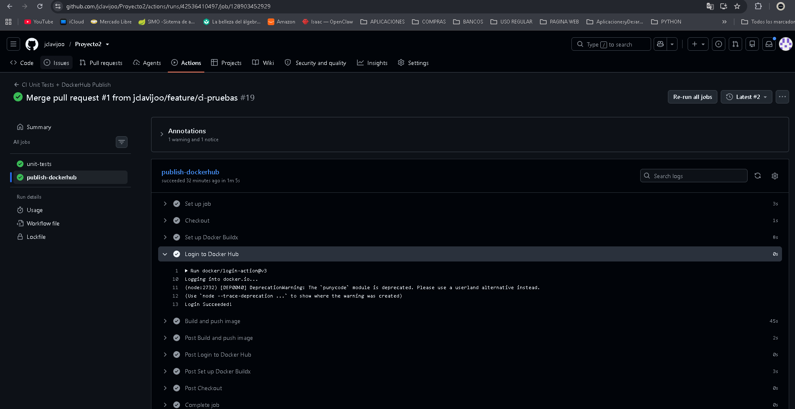
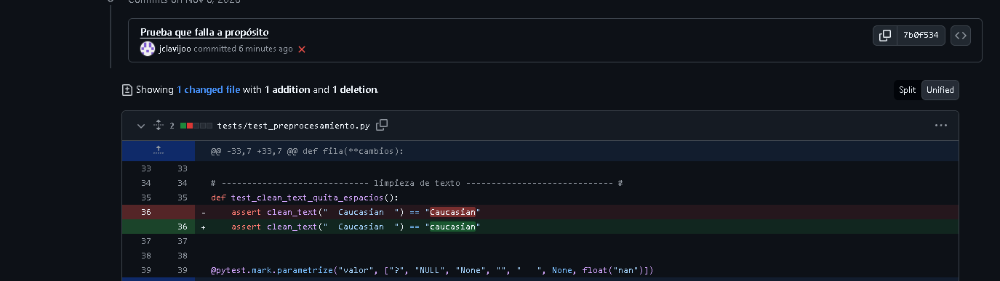
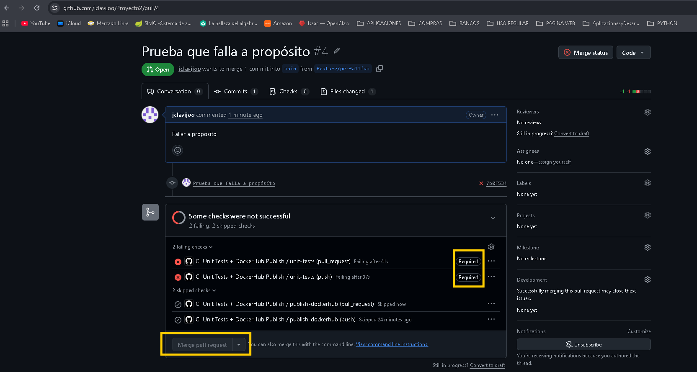
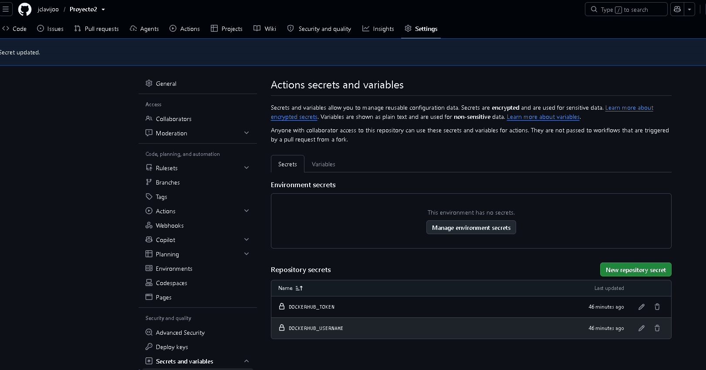

# Pruebas unitarias y CI/CD

Este documento cubre las dos actividades de `Niveles/3/CICD`: las pruebas unitarias del
preprocesamiento (Actividad 1) y el flujo de integración y despliegue con GitHub Actions
(Actividad 2). Las capturas de las evidencias están en `evidencias_tests/`.

## Actividad 1 · Pruebas unitarias

### Qué se probó

En lugar de un `app.py` de ejemplo probamos el módulo que de verdad usa el proyecto:
`api/features.py`. Es el preprocesamiento que comparten la API y el DAG de Airflow, así que si
algo se rompe ahí se rompe tanto el entrenamiento como la inferencia.

| Función | Qué hace | Tipo |
|---|---|---|
| `clean_text` | Quita espacios y convierte los marcadores de faltante del dataset (`?`, `NULL`, `None`, vacío, NaN) en cadena vacía | Limpieza de texto |
| `parse_age_bracket` | Convierte un rango de edad como `[70-80)` en su punto medio (75.0). Lanza `ValueError` si el formato no es válido | Limpieza de texto |
| `numeric_range_violations` | Revisa que las columnas numéricas sean enteras y estén dentro de sus rangos (por ejemplo, `time_in_hospital` entre 1 y 14). Lanza `ValueError` si falta una columna | Validación de rangos |
| `build_features` | Transforma una fila del CSV en las 27 columnas que recibe el modelo | Transformación de features |
| `icd9_group` | Agrupa los códigos de diagnóstico ICD-9 en 9 categorías clínicas | Transformación de features |
| `build_target`, `exclusion_reason`, `assign_split` | Variable objetivo, filas que se excluyen y partición train/val/test por paciente | Transformación de features |

### Las pruebas

Están en `tests/`. Son 21 funciones de prueba que pytest ejecuta como 42 casos, porque varias usan
`@pytest.mark.parametrize` para probar varios valores con la misma función.

`tests/test_preprocesamiento.py` (14 funciones):

| Prueba | Qué verifica |
|---|---|
| `test_clean_text_quita_espacios` | `"  Caucasian  "` queda `"Caucasian"` |
| `test_clean_text_marcadores_de_faltante_quedan_vacios` | `?`, `NULL`, `None`, vacío, solo espacios, `None` de Python y NaN quedan como `""` |
| `test_parse_age_bracket_calcula_punto_medio` | `[0-10)` → 5, `[70-80)` → 75, `[90-100)` con espacios → 95 |
| `test_parse_age_bracket_formato_invalido_lanza_error` | **`pytest.raises(ValueError)`** con `70-80`, `[80-70)`, `?`, vacío y `setenta` |
| `test_rangos_valores_en_los_limites_son_validos` | Caso borde: 1 y 14 días de hospitalización son válidos |
| `test_rangos_detecta_valores_invalidos` | Caso borde: 0, 15, 2.5, `abc` y vacío se marcan como fuera de rango |
| `test_rangos_sin_columna_obligatoria_lanza_error` | **`pytest.raises(ValueError)`** cuando falta `num_medications` |
| `test_rangos_cubren_todas_las_columnas_numericas_de_entrada` | Cada rango tiene mínimo menor que máximo |
| `test_icd9_group_agrupa_diagnosticos` | `428` → Circulatory, `250.02` → Diabetes, `V45` → Other, `?` → Missing, etc. |
| `test_build_features_devuelve_columnas_del_modelo_sin_nulos` | Las columnas salen en el orden que espera el modelo y sin nulos |
| `test_build_features_calcula_variables_derivadas` | Edad, uso de servicios, medicamentos cambiados y activos, banderas |
| `test_build_features_acepta_tipos_numericos_como_los_envia_la_api` | Funciona igual con texto (CSV) que con números (API) |
| `test_objetivo_y_exclusiones` | `<30` es 1, las altas por fallecimiento se excluyen |
| `test_particion_es_deterministica_y_proporcional` | El mismo paciente cae siempre en la misma partición y train ronda el 70 % |

`tests/test_api.py` (6 funciones). Es la parte opcional de la actividad: prueba la API con
`TestClient` y un fixture (`con_modelo`) que reemplaza el modelo de MLflow por uno de prueba, así
no hace falta tener MLflow ni PostgreSQL corriendo.

| Prueba | Qué verifica |
|---|---|
| `test_schema_rechaza_valores_fuera_de_rango` | **`pytest.raises(ValidationError)`** con 20 días de hospitalización |
| `test_rangos_de_la_api_coinciden_con_los_del_pipeline` | Los límites de la API son los mismos que usa el DAG |
| `test_health_responde_sin_modelo` | `/health` responde aunque no haya modelo |
| `test_predict_sin_modelo_responde_503` | Sin modelo productivo, `/predict` responde 503 |
| `test_predict_con_modelo_devuelve_prediccion` | Con el modelo de prueba devuelve predicción, probabilidad y versión |
| `test_predict_con_datos_invalidos_responde_422` | Un género inválido responde 422 |

`tests/test_features_identicos.py` (1 función) revisa que `features.py` sea idéntico en la API y
en Airflow. Si alguien cambia una copia y no la otra, el modelo recibiría en producción columnas
distintas a las del entrenamiento.

### Cómo ejecutarlas

Desde la raíz del repositorio:

```bash
# Local
pip install -r api/requirements.txt -r requirements-test.txt
pytest -v

# En contenedor (Dockerfile.test ejecuta pytest al arrancar, sin intervención manual)
docker build -f Dockerfile.test -t mlops-p2-tests .
docker run --rm mlops-p2-tests
```

Resultado esperado: `42 passed`.

`pytest.ini` le indica a pytest que el código está en `api/` (`pythonpath = api`), por eso las
pruebas pueden hacer `from features import ...` aunque estén en otra carpeta.

### Evidencia

Las capturas de la ejecución de las pruebas están en la sección de evidencias de la Actividad 2.

## Actividad 2 · GitHub Actions

### El workflow

Está en `.github/workflows/ci-cd-unit-tests-dockerhub.yml` y parte de la plantilla del curso.
Lo que ajustamos:

- `APP_PATH: "api"` e `IMAGE_NAME: "jclavijoo/mlops-p2-api"`.
- `paths` en el `push`: solo corre cuando cambia algo de `api/`, `tests/`, `pytest.ini`,
  `requirements-test.txt`, `Dockerfile.test`, el `features.py` de Airflow o el propio workflow.
  Un push a `main` que solo cambie el README no vuelve a publicar la imagen.
- En los `pull_request` hacia `main` no hay filtro de `paths`: las pruebas corren en todos los PR.
  Lo cambiamos después de activar la protección de `main`, porque un PR que solo tocaba
  documentación nunca recibía el check `unit-tests` y quedaba bloqueado para siempre.

Tiene dos jobs:

1. `unit-tests`: instala dependencias, corre `pytest -v` y después vuelve a correr las pruebas
   dentro del contenedor de `Dockerfile.test`.
2. `publish-dockerhub`: depende de `unit-tests` (`needs`) y además tiene la condición
   `if: github.event_name == 'push' && github.ref == 'refs/heads/main'`. En un PR aparece como
   *skipped*, y eso es lo esperado: solo se publica la imagen cuando el código ya está en `main`.
   Por la misma razón, volver a ejecutar ("Re-run") la corrida de un PR no publica nada.

Los secrets `DOCKERHUB_USERNAME` y `DOCKERHUB_TOKEN` están en *Settings → Secrets and variables →
Actions → Repository secrets*.

### Protección de `main`

En *Settings → Branches* la regla para `main` exige:

- pasar por un pull request,
- que el check `unit-tests` esté en verde,
- sin excepciones para administradores (*Do not allow bypassing the above settings*). Sin esta
  opción, como somos administradores del repositorio, GitHub nos dejaba hacer merge igual.

### Lo que hicimos

1. Rama `feature/ci-pruebas` con el módulo, las pruebas y el workflow. Al abrir el PR, `unit-tests`
   corrió y pasó; `publish-dockerhub` quedó *skipped*.
2. Merge del PR a `main`. Se disparó el workflow por `push` (commit `c3b9d85`): `unit-tests` pasó y
   `publish-dockerhub` publicó la imagen con los tags `latest` y el SHA del commit.
3. Rama `feature/pr-fallido`, donde cambiamos a propósito el valor esperado en
   `test_clean_text_quita_espacios` (`"caucasian"` en vez de `"Caucasian"`). El check falló y el
   PR quedó con el merge bloqueado. Cerramos el PR sin fusionar.

### Evidencias

Ejecución de las pruebas y del job `unit-tests`:





Publicación de la imagen y tags `latest` y `<sha>` en Docker Hub
(https://hub.docker.com/r/jclavijoo/mlops-p2-api/tags):




Reto: PR con una prueba fallida y el merge bloqueado:




Secrets del repositorio usados por el workflow:



`main` con los cambios fusionados:


### Problemas que tuvimos

- **Conflicto al abrir el PR.** Mientras trabajábamos en la rama, otro integrante subió cambios al
  README en `main`. Hubo que traer `main` a la rama (`git merge origin/main`) y resolver el
  conflicto conservando lo de ambos.
- **Secrets en el lugar equivocado.** Primero los creamos como *Environment secrets*. El workflow
  no declara ningún environment, así que no los veía; los pasamos a *Repository secrets*.
- **Login en Docker Hub.** El primer intento de `publish-dockerhub` falló con
  `unauthorized: incorrect username or password`. La cuenta de Docker Hub la abrimos con GitHub y
  no tiene contraseña propia; desde la terminal y desde Actions hay que usar un token de acceso
  personal (PAT) con permisos *Read & Write*. Con el token nuevo, *Re-run failed jobs* sobre la
  misma corrida de `main` publicó la imagen.
- Las advertencias de *Node.js 20 is deprecated* que aparecen en cada corrida son solo avisos de
  las versiones de las acciones (`actions/checkout@v4`, `actions/setup-python@v5`) y no afectan el
  resultado.
